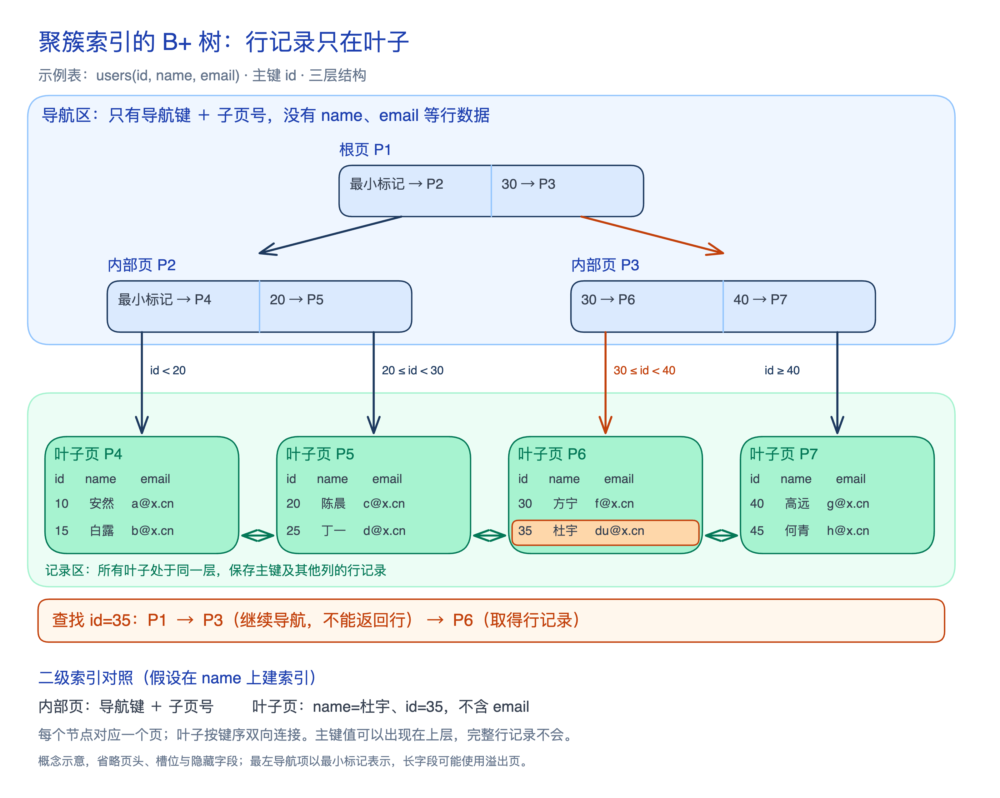

**B+ 树（B+ tree）是一种[[multiway-balanced-search-tree|多路平衡查找树]]：内部节点负责导航，数据条目集中在叶子，叶子按键顺序相连。** 这种分工有利于减少定位时的页访问，也便于范围扫描，适合 InnoDB 的常规索引。

## 节点和数据页存什么

在 MySQL 8.4 的 InnoDB 中，一个索引节点对应一个页（Page），默认大小为 16 KB，一页可以容纳多个条目。内部页保存导航键和子页号；[[mysql-clustered-index|聚簇与二级索引]]的叶子分别保存行记录，以及索引列与聚簇键。

图中的页号和记录是假设示例，省略了页内细节；结构依据来自 [[mysql-manual-queries#索引怎样找到记录|官方手册与源码说明]]，通用树结构可对照 [[opendsa-b-trees|OpenDSA 教材]]。

## 为什么选择 B+ 树

- **「少访问页面」**：内部页容纳多个分支，[[mysql-index-height|较矮的树能缩短定位路径]]。
- **「导航与数据分开」**：[[mysql-index-btree-comparison|相比经典 B 树]]，内部页专注导航，数据集中于相连的叶子，便于范围扫描。
- **「兼顾等值与范围」**：[[mysql-index-hash-comparison|相比哈希索引]]，B+ 树保留键序，不只支持单值定位。

## 读写有什么代价

读取时，[[mysql-index-height-io|树高不等于磁盘 I/O 次数]]：缓存命中减少读盘，范围扫描和回表可能增加访问。写入时，[[mysql-index-page-changes|页分裂与合并]]调整记录分布，也带来记录搬移、页面分配或回收及导航维护的成本。
