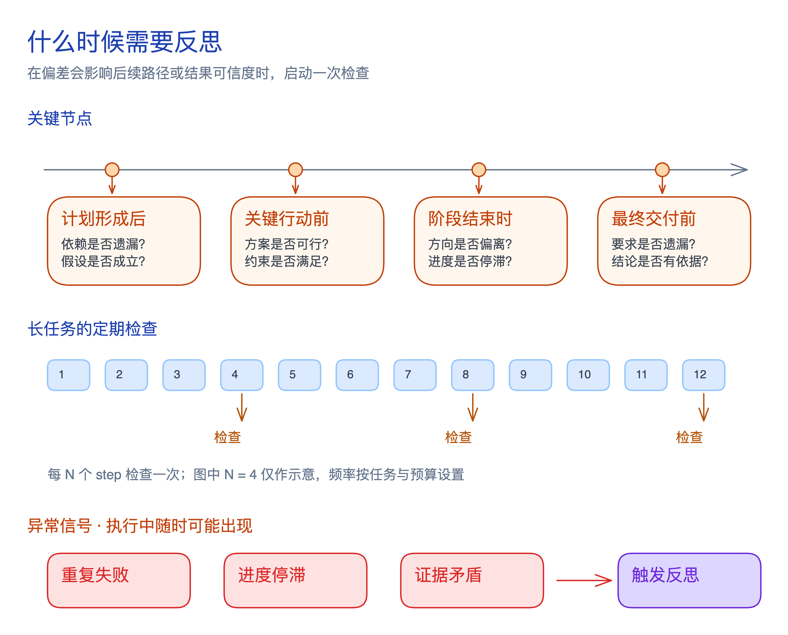
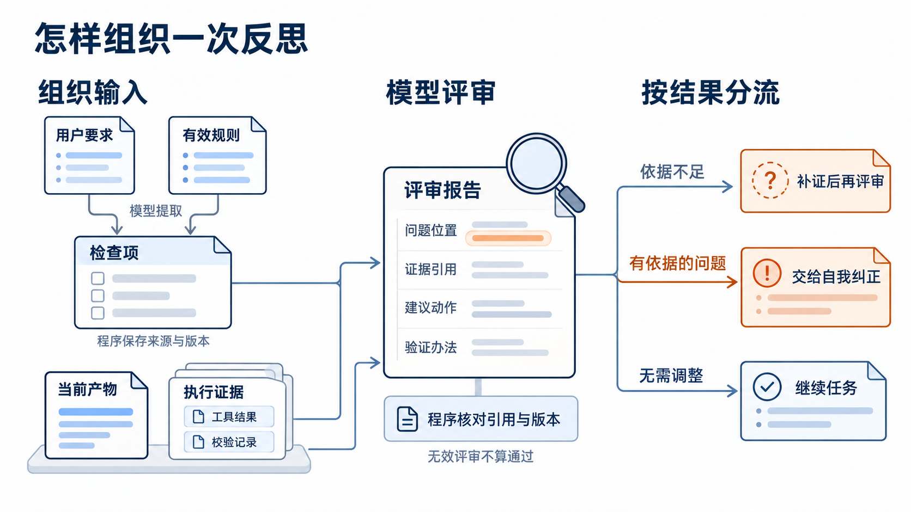

**反思（Reflection）是对照目标与证据，检查产物或执行过程、分析偏差并提出调整建议的过程。**

Agent 连续执行时可能遗漏要求、沿用错误假设或重复失败，反思让它重新核对目标与实际结果，减少错误向后传播。

## 什么时候需要反思？

优先检查可能影响后续行动或交付可信度的偏差。反思也可能误判，并增加耗时与 token 消耗；明确的参数错误通常直接修正，不必每次调用后都评审。

## 程序怎样触发反思？

**「反思可以由程序触发，不必只依赖提示词要求模型自觉检查。」** 程序读取[[agent-task-state|任务状态]]中的阶段与进度，以及工具结果、错误记录和执行步数，在阶段切换、出现错误、每完成 N 个执行步或生成候选最终答案时，按配置规则发起评审。

这些判断可以写入[[agent-loop|Agent 主循环]]，也可通过[[langchain-harness-middleware-summary|中间件钩子]]接入。**「程序决定何时评审，提示词规定怎样评审。」** 即使业务步骤由模型动态选择，模型调用前后、工具执行前后仍是程序可控制的位置；业务阶段则需要显式维护，不能仅凭一段消息自动确定。

## 怎样组织一次反思？

1. **准备检查标准**

   标准来自 **「用户要求与有效规则」**：模型提取检查项，程序保存原始要求、来源与版本。评审可补充遗漏，不能自行降低完成标准。

2. **提供当前产物与证据**

   程序提供当前版本的计划或产物，关联 **「实际工具结果与校验记录」**，并标明缺失或截断。模型声称「已查询」不能代替执行证据。

3. **评审并分流**

   提示词要求模型逐项指出问题位置、依据、建议动作与验证办法，程序核对引用和版本。根据 **「证据是否充分、问题是否成立」**，选择补证后再评审、交给[[agent-self-correction|自我纠正]]或继续任务；无效评审不能算通过。[[critic-summary|CRITIC]]展示了用工具补充核验依据的做法。

程序限制评审次数、时间和 token 消耗，持续无进展时停止并保留未解决项；**「评审结束不等于任务完成。」** 后续修改与验证按[[agent-feedback-mechanisms|反馈与调整机制]]衔接，并用[[anthropic-agent-evals-summary|任务评测]]比较修复率、误改率与新增成本。

跨任务复用时，[[reflexion-summary|Reflexion]]将反馈保存为文字经验；[[agent-memory-experience|经验记忆]]保留行动、验证结果与适用条件，未经核实的归因仍作为假设。
