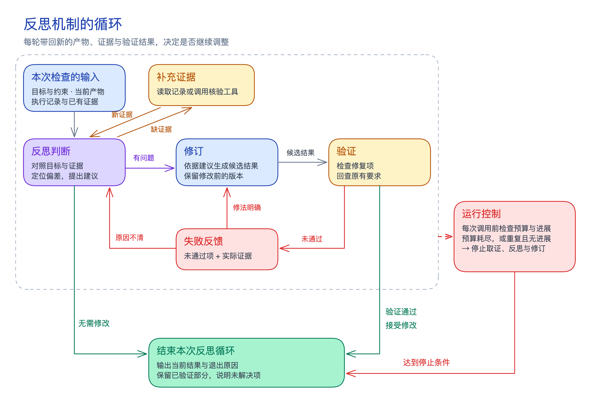

Agent 执行长任务时，可能偏离目标、遗漏依赖，或把无依据的推测带入后续决策。**反思（Reflection）是对照目标与证据，检查产物或执行过程、分析偏差并提出调整建议的过程。**

反思回答「哪里有问题、依据是什么、怎样调整」；[[agent-self-correction|自我纠正]]负责落实修改并验证。反思也可以得出「无需修改」或「证据不足」。两种职责可以由同一次模型调用承担，不要求独立模块或另设 Agent。

## 什么时候需要反思？

优先在**偏差会影响后续路径或结果可信度**的节点检查：

- **计划形成后、关键行动前：** 检查依赖与假设，减少后续返工。
- **阶段结束或每完成 N 个 step 后：** 对照原目标检查方向与进度。
- **重复失败、停滞或证据矛盾时：** 判断原有做法是否需要调整。
- **最终交付前：** 核对要求是否遗漏、结论是否有依据。

不必每次调用后都反思。额外评审会增加延迟与 token 消耗，反复修改还可能引入错误；触发频率应结合任务风险与预算确定。

## 反思怎样形成完整循环？

这里的循环是**一次反思机制内部的反馈与调整**：对照目标检查当前结果，必要时取证或修订，再根据验证反馈决定是否继续。它可以在[[agent-loop|Agent 主循环]]的检查节点被触发，但两者是不同层次的循环。

反思先对照目标、当前产物与[[critic-summary|工具核验结果]]定位偏差；证据不足时先取证，有问题时由自我纠正生成候选修改，再检查修复项与原有要求。验证反馈决定继续修订还是重新分析，避免仅凭建议接受修改。

无需修改、验证通过，以及预算耗尽或持续无进展，都结束本次循环，并记录各自的退出原因。验证通过才能接受候选修改；达到停止条件时保留已验证结果，说明未解决项。结束本次循环不等于整个任务完成。

检查项、证据与这些分支怎样接入运行程序，由[[agent-reflection-implementation|Agent 反思实现]]展开。

## 怎样用于后续尝试？

[[reflexion-summary|Reflexion]]将执行反馈归纳为文字经验，存入记忆供后续尝试读取，通过改变上下文影响行为，无需更新模型权重。它是具体方法名，Reflection 是通用过程。

跨任务复用按[[agent-memory-experience|经验记忆与技能复用]]保留适用条件、实际结果和依据。一次成功不能证明归因正确；未验证的归因先作为假设，复用前核对条件，出现反例则停用并重新核验。

## 怎样应对反思带来的问题？

反思本身也会误判，需要守住以下边界：

| 风险 | 控制要点 |
| --- | --- |
| 把正确结果改错 | 候选修改验证后才接受，同时检查原有要求是否退化 |
| 漏检并错误放行 | 必需项分别记录通过、失败或未知，并关联证据；未知不能算通过 |
| 目标漂移 | 建议关联原要求，不能直接改写完成条件；新增偏好作为可选项 |
| 成本失控或循环 | 设置轮数、时间与 token 上限；问题重复且无新证据或进展时退出 |

这些控制仍受标准与证据质量限制：计算正确不代表数据口径一致，测试通过也不代表覆盖全部要求。[[intrinsic-self-correction-summary|无外部反馈的推理纠正研究]]在其测试条件下观察到误改与性能下降，说明多检查一次不保证更好，但不能据此断言所有反思都有害。

[[anthropic-effective-agents-summary#什么时候适合评估后再改进？|评估—改进模式]]需要清楚的标准与可衡量的收益。按[[anthropic-agent-evals-summary|Agent 评测方法]]，在同组任务、可比预算下比较修复率、误改率、任务完成情况与新增成本，必要时用人工校准。**是否保留反思步骤，要看实际净收益。**
