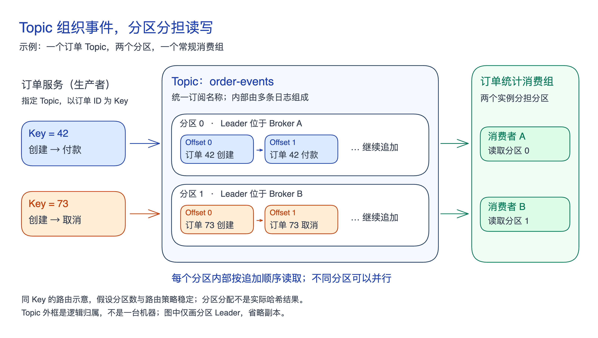

Kafka 用 Topic 组织业务事件，再用分区分担读写：**「Topic 决定哪些记录放在一起，分区决定这些记录怎样分开存储和处理。」**

## Topic（主题）

**Topic 是 Kafka 中有名称的事件流，是生产者写入和消费者订阅的逻辑对象。**

例如订单服务向 `order-events` 写入创建、付款等事件，统计应用订阅这个 Topic。用名称组织事件后，应用可以选择所需数据，系统也能按 Topic 设置保留期限和访问权限；不必把不同业务的记录混在一个统一入口里。

Topic 可以包含一种或多种事件类型，也不专属于某个服务。是否拆开，主要看消费需求、相关事件的顺序要求和管理条件是否一致，具体取舍见[[kafka-model-sources#Topic 怎样划分|Topic 划分导读]]。

## Partition（分区）

**Partition 是 Topic 内的一条有序追加日志，也是分散存储与并行消费的单位。**

如果一个 Topic 只有一个分区，常规消费组中同一时刻只有一个消费者负责它，无法靠增加组内消费者来分担这条日志。拆成多个分区后，日志可以分布到不同 Broker（存储服务器），组内不同消费者也能同时处理各自分区。

分区保存的是**「不同的记录」**；副本则保存同一分区的多份数据，用于故障恢复。两者分别解决分担工作与冗余保存的问题，一台 Broker 也可以承载多个分区。

## 写入与读取怎样配合

下图假设以订单 ID 为 Key，采用稳定的按 Key 路由；同一订单先写创建事件，再写后续变化。两个消费者属于同一个常规消费组，图中只展示分区的 Leader（负责该分区读写的副本）。

每条记录只追加到其中一个分区，多个分区不是把所有事件各存一遍。Key（键）帮助选择分区；不同 Key 仍可能落入同一分区。Offset（偏移量）表示记录在分区内的位置，需与 Topic、分区一起定位记录。

并行带来的边界是**「只保证分区内的追加顺序，没有跨分区的统一顺序」**。图中两个 Offset 0 不能用来判断谁先发生；Kafka 也不会按业务时间戳重新排序，应用仍需正确安排写入与处理次序。

Key 过于集中会形成热点，增加分区又可能改变 Key 映射，旧记录不会自动搬迁。因此“同 Key 同分区”有路由策略和分区数等前提，具体条件见[[kafka-model-sources#分区带来什么，也限制什么|分区与路由导读]]。
