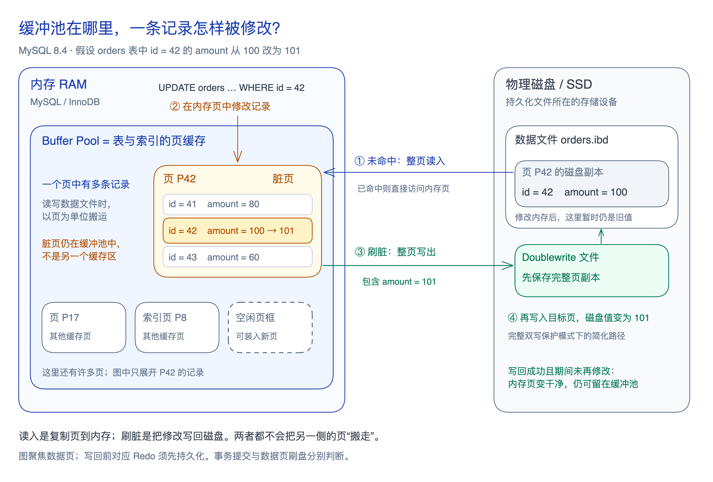

**缓冲池（Buffer Pool）是 InnoDB 按页缓存表和索引数据的内存区域，通过复用页面和延迟写回减少数据文件 I/O。** 以下以 MySQL 8.4、常规未压缩页为范围。

**脏页（Dirty Page）是内存中已修改、对应修改尚未写回数据文件的页。**

图中为假设数据，展示完整双写保护下的数据页路径，省略日志与操作系统 I/O 层。机制依据见[[mysql-manual-buffer-pool|官方专题导读]]。

## 缓存与写回

| 问题 | 机制与边界 |
| --- | --- |
| 保留哪些页 | [[mysql-buffer-replacement\|LRU 与延迟提升]]降低一次性扫描挤走热点的风险；新旧区与页是否干净无关。 |
| 何时提前加载 | [[mysql-read-ahead\|预读]]根据访问模式异步加载页面，收益取决于后续是否实际使用。 |
| 何时写回 | [[mysql-dirty-page-flushing\|后台刷脏与检查点]]应对脏页积累、缓存回收和 Redo 空间压力；无需一次刷空缓冲池。 |
| 写回中途失败 | [[mysql-doublewrite\|双写缓冲]]提供完整页副本，用于修复部分页写入。 |

[[wal|WAL]]要求对应 Redo 先持久化，再写回数据页；它不要求修改内存页之前先刷日志。**「页是否干净」与「事务是否提交」分别判断**：未提交的修改也可能已写入数据文件，故障后仍需[[mysql-manual-recovery#Redo 怎样参与本机恢复|重做与回滚]]处理事务状态。

缓冲池缓存页面，不缓存 SQL 结果；命中后仍有定位、可见性判断与计算。高命中率也不保证低延迟，写回积压或 I/O 竞争仍可能拖慢请求。
