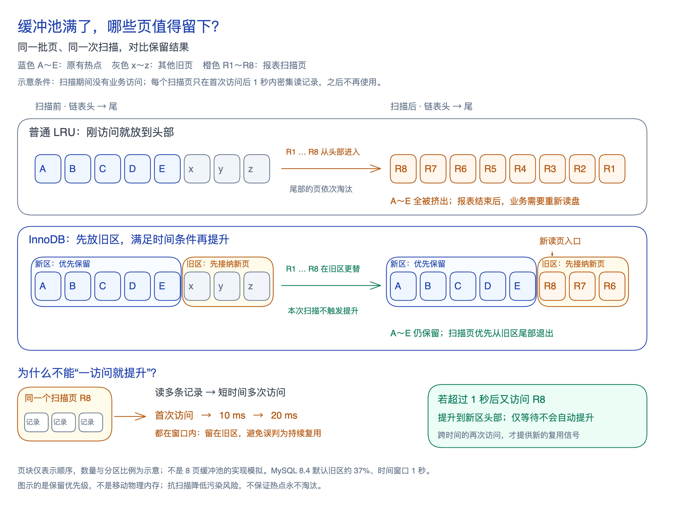

**缓冲池容量有限，装不下所有数据，因此需要淘汰策略：为新页腾出空间，同时尽量留下后续还会使用的页，减少重复读盘。**

**LRU（Least Recently Used，最近最少使用）按访问的新近程度决定保留顺序。** 普通 LRU 将刚访问的页放到链表头部，优先淘汰最久未访问的尾部页。但一次扫描也能让大量临时使用的页排到前面，挤走原有热点；这就是「扫描污染」。

**InnoDB 使用带有扫描保护的 LRU 变体。** 新读入页先放旧区；从首次访问开始，经过时间窗口后再次访问，才提升到新区头部。它通过**「先放旧区＋延迟提升」**，降低短期密集访问被当作持续复用的机会。

**因此，同样面对一次性大扫描，普通 LRU 容易让扫描页挤走热点；InnoDB 让未满足提升条件的扫描页优先在旧区更替，给原有热点更多保留机会。**

图中为简化示意。MySQL 8.4 的时间窗口从首次访问开始，由 `innodb_old_blocks_time` 控制；分区比例与条件见[[mysql-manual-buffer-pool#缓存保留与预读|官方导读]]。

延迟提升也可能让有用的新页过早退出，窗口并非越长越好，[[mysql-scan-resistance-readings|图解与实验导读]]保留了相应反例。新旧区与页是否干净无关，脏页淘汰前仍须[[mysql-dirty-page-flushing|写回]]。
