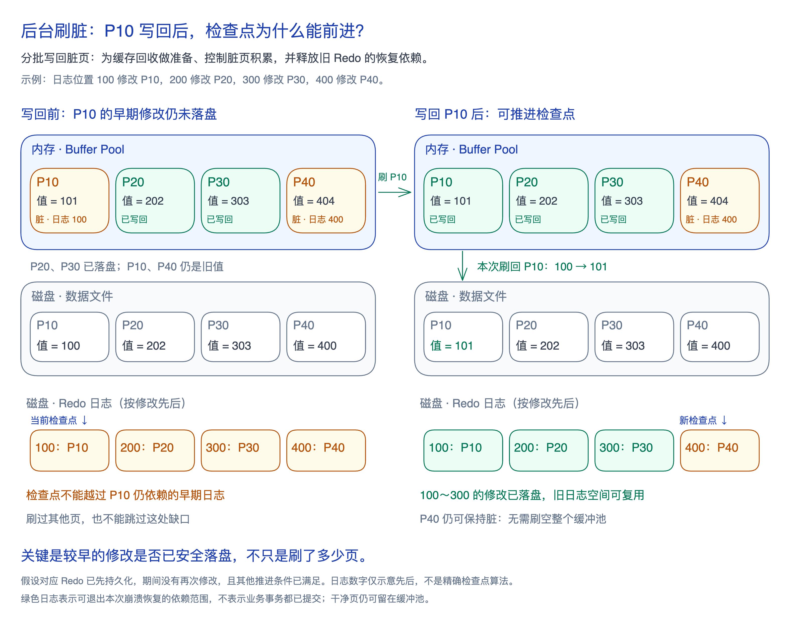

修改先留在缓冲池里，可以延后写盘；但脏页和 Redo 都不能无限积累。**InnoDB 需要持续把修改写回数据文件，为缓存回收和旧日志空间复用创造条件。**

**后台刷脏是清理线程分批写回脏页的过程。** 它既应对脏页积累，也为淘汰旧页准备空间，并根据日志生成和写回速度调整节奏，减少临时集中写盘造成的等待。

**检查点（Checkpoint）是崩溃恢复开始重做的日志位置标记。** 它之前的修改已反映在数据文件中；较早的修改还未写回，就不能跳过它依赖的日志。

**刷脏解决「修改何时落盘」，检查点记录「恢复还需从哪里开始」；推进检查点取决于较早修改是否落盘，不只取决于刷了多少页。** InnoDB 分批推进，无需暂停业务并刷空缓冲池。

写回须满足 [[wal|WAL]]：对应 Redo 先持久化；刷脏不等于事务提交。写回长期跟不上修改时，扩大缓冲池或 Redo 只能增加缓冲余地；节奏取舍和观察指标见[[mysql-manual-buffer-pool#刷脏与检查点|官方导读]]。图为 MySQL 8.4 机制的简化推演。
