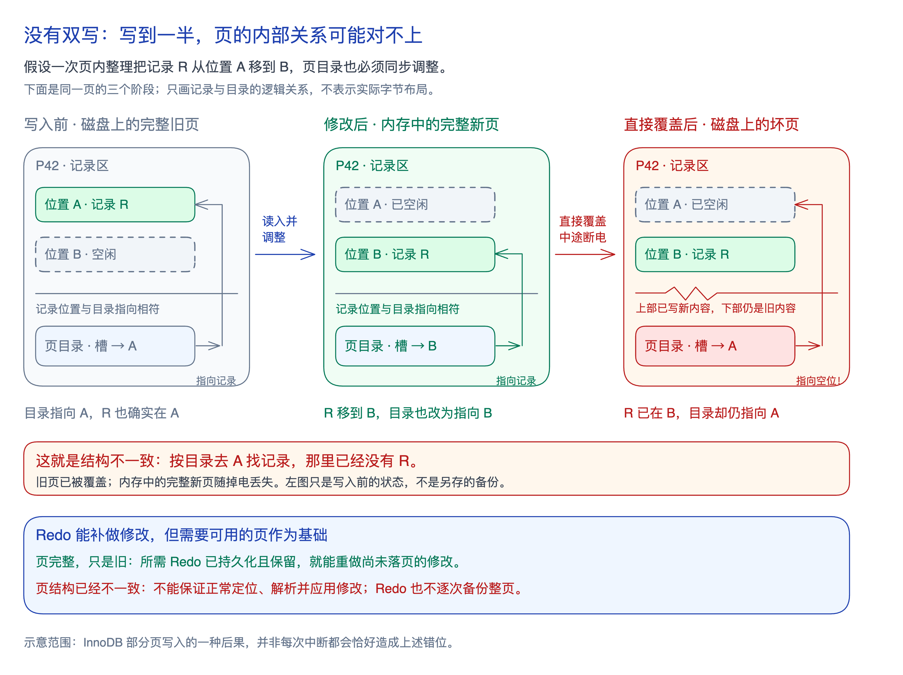

脏页最终要写回数据文件。如果直接覆盖磁盘上的旧页，写到一半掉电，就可能留下**新旧内容混合、内部结构不一致的坏页**；内存中的完整新页也会随掉电丢失。

已有的 [[mysql-manual-recovery#Redo 怎样参与本机恢复|Redo（重做日志）]]，保存的是**重做数据修改所需的信息**，并不为每次修改保存整页备份。**页完整、内部一致，且所需 Redo 已持久化并保留，就能通过重做补齐修改。** 但页结构损坏后，连记录的定位与解析都可能不可靠，日志也未必包含重建整页所需的全部内容，因此不能保证仅靠 Redo 修好坏页。

**双写缓冲（Doublewrite Buffer）先把完整页副本持久化到磁盘双写文件，再覆盖目标页。** 在 MySQL 8.4 的完整双写保护下：

- **副本写坏：** 原数据页尚未覆盖，仍然完整；丢弃无效副本，恢复时可在旧页上应用 Redo。
- **副本安全落盘后：** 才开始写目标页；目标页若写坏，先用完整副本修复，再按需应用 Redo。

安全性来自这个先后顺序。副本写入失败表示本次刷页未完成，不等于事务失败；对应日志仍须按 [[wal|WAL]] 先持久化。

双写增加写入成本，但批量顺序写使耗时不必恰好翻倍；它不是历史备份，不能撤销正常提交的误删。`DETECT_ONLY` 只检测、不提供完整页修复，模式和存储条件见[[mysql-manual-buffer-pool#写回过程的完整性|官方导读]]。
