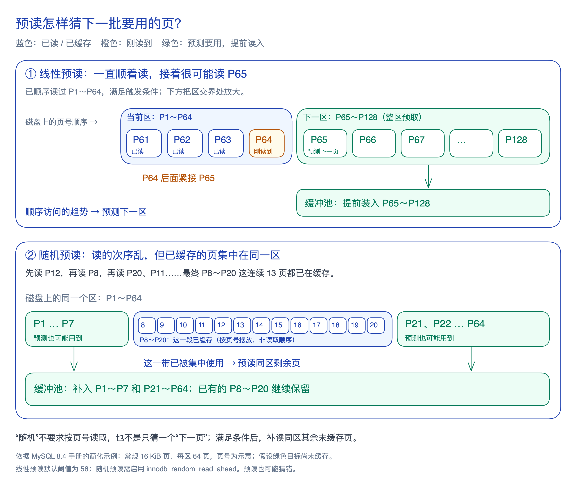

缓冲池缓存已加载的页；要进一步减少后续读盘等待，还可以预测接下来需要哪些页，提前加载。

**预读（Read-Ahead）是 InnoDB 根据页面访问情况，异步提前加载可能要用的页的机制。** 两种方式的区别在于预测依据和读取范围：

- **线性预读：**当前区的顺序访问达到阈值，预取**「下一个区」**。
- **随机预读：**不要求读取顺序，根据同一区内已缓存页的分布，补读**「同一个区的其余页」**。

区（extent）是连续页的空间分配单位。图中用具体页号说明：顺序读到 P64 后预测接着读 P65；乱序读入的页集中在 P8～P20 时，预测同一区其余页也可能用到。

**线性预读推测访问会向后延续，随机预读推测同一区的其他页也会被使用；两者都希望把读盘提前完成。** 「随机」不表示随机选择页。具体触发条件、配置与指标见[[mysql-manual-buffer-pool#预读条件与效果观察|官方导读]]。

预测错误会浪费 I/O 并占用缓存；[[mysql-buffer-replacement|旧区与延迟提升]]可减少未使用页对热点的挤占，却不能收回已花费的 I/O。
